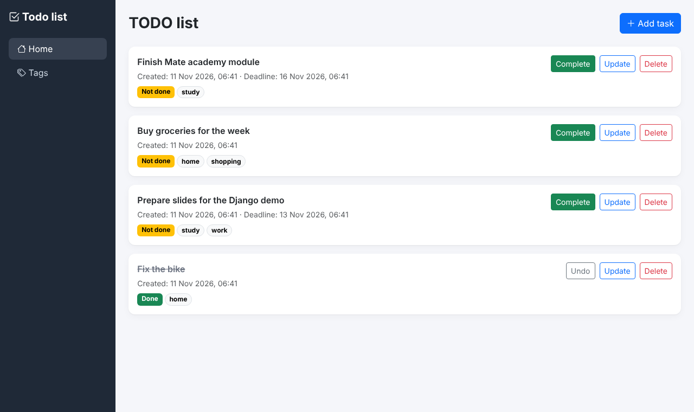
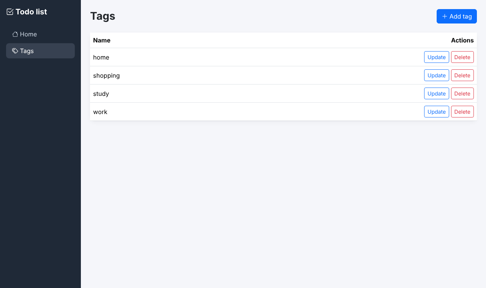

# Todo List

A Django todo list: tasks with optional deadlines and tags, a Complete/Undo
button and a tag list page.

## Run locally

```bash
python -m venv venv
source venv/bin/activate            # Windows: venv\Scripts\activate
pip install -r requirements.txt
python manage.py migrate
python manage.py runserver
```

Open http://127.0.0.1:8000/. Run the tests with `python manage.py test`.

## Pages

- `/` — todo list: not done tasks first, newest first; add, update, delete,
  Complete / Undo
- `/tags/` — tag list with add, update and delete

## Screenshots



